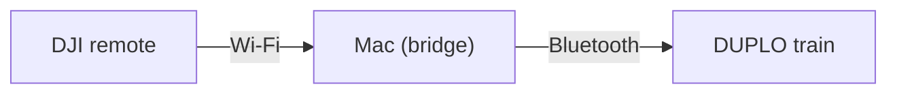

# DUPLO Control

Drive a LEGO DUPLO smart train with a DJI RC (RM330) remote.

## The idea

I don't want to give my child a screen. I wanted a cool remote for the train.

ESP32 is cool, but a 3D-printed plastic case is not as cool as a DJI remote with a sticker on it. So I made this app to use the DJI remote I already have.

## How it works

**Your Mac is the bridge.** The app reads the remote's stick movement over Wi-Fi and sends commands to the train over Bluetooth.



Everything runs locally on the Mac. Keep the app window open and in focus while driving.

## Drive

- Push the left stick up to go forward.
- Push it down to go backward.
- Move it to the center to stop.
- Use the Mac to set the speed, change the light color and play sounds.

You can also drive with the keyboard or buttons on the Mac.

## Start

With `uv` and Node.js installed, set up once:

```sh
uv venv .venv
uv pip install --python .venv/bin/python -r requirements.txt
cd ui
npm ci
npm run build
cd ..
```

Start the app:

```sh
.venv/bin/python app_server.py
```

Open [the app](http://127.0.0.1:8100).

1. Turn on the train and close the LEGO app on your phone.
2. Turn on the remote and connect it to the same Wi-Fi as the Mac.
3. Click **Connect both**. Wait for both devices to connect.
4. Center the left stick, then drive.

To connect just one device, choose **Train only** or **Remote only**. If a connection drops, click **Reconnect** in the top bar.

Stop the app with **Ctrl+C**.

## Try without a train

Run the demo:

```sh
.venv/bin/python app_server.py --demo --port 8101
```

Open [the demo](http://127.0.0.1:8101).

More details: [app controls](docs/app-behavior.md), [DJI remote setup](docs/dji-remote.md).
